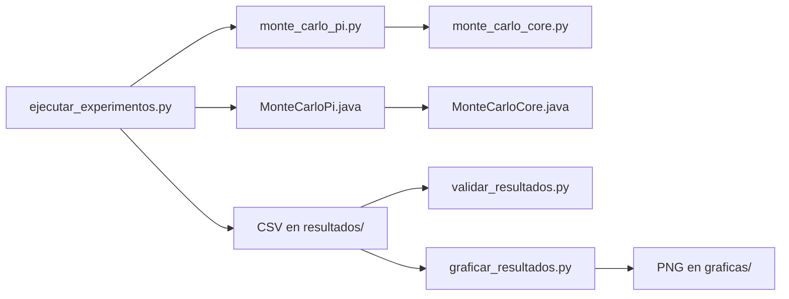

# Arquitectura del APE7

Se usa una arquitectura ligera de **dominio, aplicación e infraestructura**, distribuida por archivos y funciones. No se crearon capas de clases abstractas ni carpetas adicionales: el proyecto tiene dos programas pequeños y herramientas de experimento en Python.

| Capa | Módulos reales | Responsabilidad |
|---|---|---|
| Dominio | `python/monte_carlo_core.py`, `java/MonteCarloCore.java` | LCG de 32 bits, dos uniformes por punto, condición `x*x+y*y <= 1.0`, `4Nc/N` y error absoluto. Sin CSV, gráficas ni cronómetro. |
| Aplicación | `python/monte_carlo_pi.py`, `java/MonteCarloPi.java`, `tests/ejecutar_experimentos.py` | Validar `N` y semilla, coordinar la corrida y repeticiones, medir solo el conteo, comprobar igualdad por pareja. |
| Infraestructura | Salida `clave=valor` de ambos CLI; `write_csv` en `tests/ejecutar_experimentos.py`; `tests/graficar_resultados.py` | Presentar resultados, guardar CSV y producir PNG. `tests/validar_resultados.py` audita los archivos sin simular de nuevo. |

Los programas pueden ejecutarse directamente con `N` y semilla. El ejecutor invoca ambos y compara sus salidas; guarda `corridas.csv`, la tabla de cinco columnas y el resumen estadístico. El auditor verifica esos archivos y el generador de figuras los lee. Los detalles y comandos están en `README.md`.

La separación elimina la mezcla anterior de matemática con CLI y cronómetro en cada lenguaje. Las herramientas de CSV y gráficas permanecen en Python, donde ya funcionaban. Los datos de las 160 corridas y las cuatro gráficas de la fase 3 se conservaron sin recalcular tiempos ni modificar formatos.
